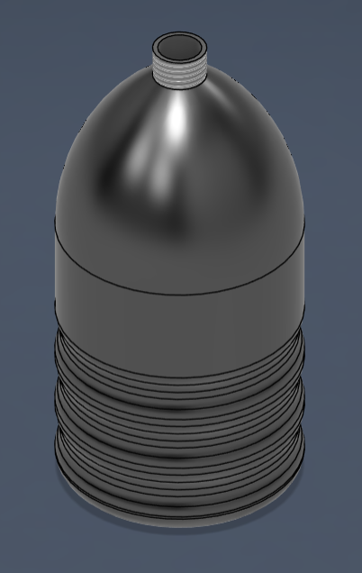
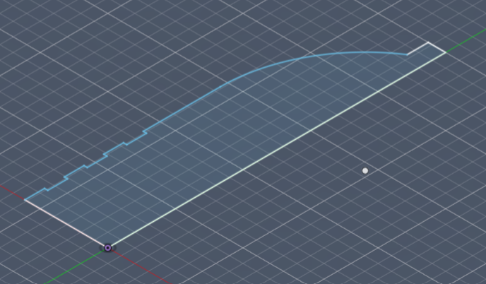

# Water Bottle (v1.0)

## Overview

My first CAD project, created in Autodesk Fusion 360 by following the *Fusion 360 Water Bottle Tutorial* by Product Design Online.

The objective was to become familiar with the CAD environment and learn how basic sketches and modeling features can be combined to create a three-dimensional object.

## Software
- Autodesk Fusion 360

## Modeling Process

The model was created step by step following the tutorial. The process introduced:

- Creating and dimensioning 2D sketches
- Using the Revolve feature to generate rotationally symmetric geometry
- Applying fillets to round edges
- Modifying and combining basic geometry
- Navigating the Fusion 360 modeling environment

## Key Takeaways

This project introduced me to the relationship between a 2D sketch and the resulting 3D geometry.

It also provided my first experience working with parametric features and a feature-based CAD workflow.

The model was created as a guided tutorial exercise rather than an independently developed product design.

## Tutorial Reference

[Product Design Online – Fusion 360 Water Bottle Tutorial](https://youtu.be/s5tRWYkxu9o)

## Preview

### Final Model

### Sketch

